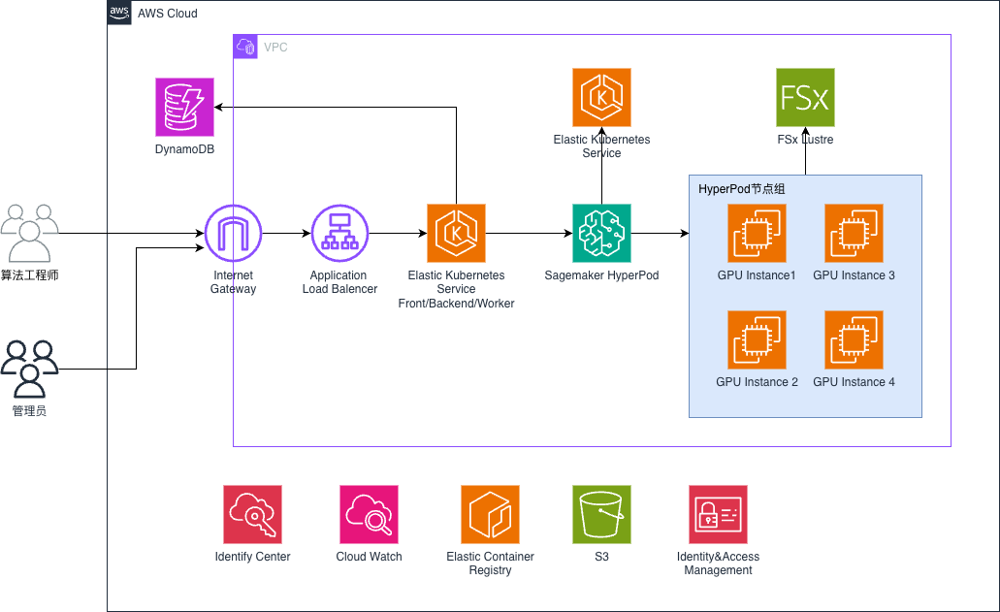

# HyperPod UI Platform

**English** | [简体中文](README.zh-CN.md)

A multi-tenant ML platform built on Amazon SageMaker HyperPod + Amazon EKS. One web portal for Workspaces, dev instances, training jobs, inference services, quotas, monitoring, and logs.

## Why HyperPod UI Platform

SageMaker HyperPod gives you a resilient, large-scale GPU cluster. Sharing that cluster across many teams usually means everyone works with Kubernetes YAML, `kubectl`, and Kueue directly. It is hard to see who is using which GPUs or why a job is still queued, and nothing stops one team from deleting another team's job. This sample adds a self-service portal on top of HyperPod. Platform admins split the cluster into governed Workspaces, and ML engineers develop, train, and serve models from the browser without ever touching Kubernetes.

**Key advantages**

- **Covers the whole ML lifecycle.** You can go from a notebook to distributed training to a production inference endpoint in one UI: dev instances (JupyterLab / Code Editor / native SSH), PyTorch and Ray training, and single-node, llm-d multi-node, and NVIDIA Dynamo multi-node inference.
- **Built on native HyperPod and AWS building blocks, not custom schedulers.** A Workspace maps to a HyperPod task governance compute quota (namespace + Kueue queue + ResourceQuota). Priority classes come from the HyperPod cluster policy. Dev instances use the SageMaker Spaces add-on, and training uses the HyperPod Training Operator with auto-resume. The platform adds no custom operators or webhooks to the HyperPod cluster, so it stays close to what AWS supports and upgrades cleanly.
- **Fair, governed GPU sharing.** You get separate GPU and CPU resource pools, per-Workspace quotas with borrowing, priority classes, a per-Workspace preemption switch, and a Task Overview that shows the real queue order and lets admins re-prioritize queued tasks. Every task is created from admin-defined resource templates, so users can't request arbitrary sizes.
- **Resilient training by default.** Jobs run on HyperPod auto-resume and the `hyperpodrun` elastic agent. Preempted or failed jobs are re-queued and resume from their checkpoints.
- **Observability built in.** Metrics include per-Pod GPU metrics from DCGM (not per node, so fragmented scheduling doesn't dilute utilization), SGLang serving performance, Kueue queue and quota usage, FSx performance, and a Workspace GPU utilization and occupancy chart. Logs include live and historical logs with search across Pods, plus an optional S3 archive for long-term retention.
- **Shared data with guardrails.** Multiple FSx for Lustre file systems can be mounted per Workspace, with subdirectory isolation and per-directory capacity quotas (Lustre project quotas). S3 mounts are also supported. Dev instance home directories are persistent EBS volumes that survive stop and start.
- **Enterprise identity and security.** Sign-in goes through Amazon Cognito, optionally federated with IAM Identity Center (SAML, including cross-account setups). There are three roles (platform admin / Workspace admin / member), and authorization is enforced at every endpoint. An audit log is kept in DynamoDB. Users can create personal API tokens and secrets for CLI and CI use. The deployment is private by default: an internal ALB and a private EKS API endpoint.
- **Developer productivity.** Tasks are created with guided forms and a YAML preview, and any task can be cloned to run again. Image Hub includes online Dockerfile builds (AWS CodeBuild). Inference APIs are OpenAI-compatible. Dev instances, jobs, and services can be shared read-only within a Workspace. Dev instances get stable SSH DNS names for VS Code Remote-SSH.
- **Low operating overhead.** DynamoDB (on-demand) is the single source of truth, and there are no RDS or Redis clusters to run. The API is stateless and scales horizontally. A Go controller projects cluster state into DynamoDB in real time. The whole platform is deployed by AWS CDK plus three scripts.
- **Ready for global teams.** The UI is bilingual (English / Simplified Chinese), and in-app user guides and a GPU fault runbook are included.

## Features

| Area | What you get | Built on |
|---|---|---|
| Workspace | Team isolation unit: members, quota, FSx/S3 mounts, Workspace admins | HyperPod task governance `ComputeQuota` → namespace + `ResourceQuota` + Kueue queue |
| Dev Instance | JupyterLab / Code Editor in the browser, native SSH with a fixed DNS name, persistent EBS home | SageMaker Spaces add-on (`workspace.jupyter.org` CRD) |
| Training Job | Distributed PyTorch with auto-resume, sectioned create form, clone & rerun | HyperPod Training Operator + `HyperPodPyTorchJob` (`hyperpodrun`) |
| Ray Job | Ray distributed training | KubeRay `RayJob` |
| Single-node Inference | SGLang (also vLLM / TRT-LLM), models from FSx/S3, OpenAI-compatible API, exposed via ClusterIP / internal ALB / optional SageMaker endpoint | HyperPod `InferenceEndpointConfig` |
| Multi-node Inference | Models too large for one node: unified gateway + multiple leader/worker replica groups, cache-aware routing | llm-d (`LeaderWorkerSet` + sgl-gateway) |
| Dynamo Inference | Multi-node TP/EP inference for very large models (e.g. DeepSeek-V3), OpenAI-compatible API | NVIDIA Dynamo (`DynamoGraphDeployment` + Grove) |
| Resource Template | Admin-defined instance specs shared by all task types; users pick, never type | Per-Workspace templates, GPU/CPU pools |
| Quota & Scheduling | GPU/CPU resource pools, priority classes, per-Workspace preemption switch, Task Overview with queue order and priority changes | Kueue ClusterQueue/LocalQueue + HyperPod task governance cluster policy |
| Storage | Multiple FSx for Lustre file systems, per-directory capacity quotas, FSx performance monitoring, S3 mounts | FSx for Lustre 2.15 project quotas |
| Image Hub | ECR image catalog + online Dockerfile builds | Amazon ECR + AWS CodeBuild |
| Monitoring & Logs | GPU/Pod/SGLang metrics, Kueue queue page, live + historical logs with search across Pods, optional S3 log archive | ECharts + Amazon Managed Service for Prometheus + CloudWatch Logs (Fluent Bit) |
| Sharing & Token Center | Read-only sharing within a Workspace; personal API tokens and key-value secrets | DynamoDB |
| Identity & Access | Platform admin / Workspace admin / member, audit log | Cognito user pool (+ IAM Identity Center SAML) |

> The KubeRay operator for Ray Jobs is installed automatically by `deploy/deploy-platform.sh` (`init` step). For Dynamo Inference, you install the NVIDIA Dynamo platform (with Grove) on the business cluster yourself.

## Architecture



## Deployment

> **Start here: [`docs/deployment-guideline.md`](docs/deployment-guideline.md)**. It walks through a complete deployment from scratch.

The deployment uses two EKS clusters in the same VPC:
- **Business cluster** (created in the console with HyperPod custom setup): HyperPod / FSx / dev instances / training / inference
- **Platform cluster** (created by CDK): frontend, backend, and controller

Main flow (see the guide for details):

```
① Console: create VPC / EKS + HyperPod / FSx   →   ② Fill in infrastructure/cdk.json
   →  ③ deploy/cluster-prereq.sh        (prepare the business cluster)
   →  ④ deploy/deploy-platform.sh cdk init build apply   (deploy the platform)
   →  ⑤ Finish: cognito-callback.sh + cross-cluster-sg.sh + domain / IAM Identity Center
```

Three deployment scripts (`deploy/`):

| Script | Stage |
|---|---|
| `cluster-prereq.sh` | Business cluster prep (EBS CSI / SSM / Prefix Delegation / Spaces / external-dns / logging / template / fsx-admin / LWS) |
| `deploy-platform.sh` | Platform deployment (cdk → init → build → apply) |
| `cognito-callback.sh` | Finish (set the Cognito callback URL) |

We recommend deploying from an EC2 instance inside the VPC. See [`docs/ec2-deployer-setup.md`](docs/ec2-deployer-setup.md).

## Tech Stack

- **Backend**: Python 3.11 + FastAPI + aioboto3 + DynamoDB (single source of truth)
- **Controller**: Go + controller-runtime (projects CR / Kueue Workload / Pod status into DynamoDB)
- **Frontend**: Vite 5 + React 18 + TypeScript 5 + Ant Design 5 + ECharts 5, i18next (en-US / zh-CN)
- **Infrastructure**: AWS CDK v2 (aws-cdk-lib 2.150)
- **Clusters**: EKS 1.35 + SageMaker HyperPod + Kueue + amazon-sagemaker-spaces
- **Data / auth**: DynamoDB + Cognito + Amazon Managed Service for Prometheus

## Repository Structure

```
infrastructure/              CDK (Python): platform cluster + DynamoDB / Cognito / IAM / ECR / Pod Identity
services/platform-api/       FastAPI backend (DynamoDB as the single source)
services/platform-controller/ Go controller: watches the business cluster, writes status to DynamoDB
frontend/                    Vite + React 18 + Ant Design 5 frontend
deploy/                      Deployment scripts + Kubernetes manifests
docs/                        Deployment, integration, and design docs
```

## Documentation

Every doc is available in English and Simplified Chinese (`*.zh-CN.md`). Use the switcher at the top of each page.

| Doc | Contents |
|---|---|
| [deployment-guideline.md](docs/deployment-guideline.md) | ⭐ **Start here**: full deployment from scratch |
| [ec2-deployer-setup.md](docs/ec2-deployer-setup.md) | Set up an EC2 deployer instance |
| [identity-center-cognito-configuration.md](docs/identity-center-cognito-configuration.md) | Connect IAM Identity Center (SAML) to Cognito |
| [internal-domain-deployment.md](docs/internal-domain-deployment.md) | Internal domain + private certificate + ALB HTTPS |
| [internal-alb-with-domainname.md](docs/internal-alb-with-domainname.md) | CloudFront + VPC origin + internal ALB |
| [WebSocketProxyFix.md](docs/WebSocketProxyFix.md) | Code Editor WebSocket issue behind CloudFront |
| [controller-deployment.md](docs/controller-deployment.md) | platform-controller deployment |
| [fsx-storage-quota-design.md](docs/fsx-storage-quota-design.md) | FSx directory quota design |
| [fsx-mount-pv-pvc-cr-explained.md](docs/fsx-mount-pv-pvc-cr-explained.md) | How FSx is mounted (PV / PVC / CR) |
| [dynamo-inference-sync-design.md](docs/dynamo-inference-sync-design.md) | Dynamo inference status sync design |
| [i18n-glossary.md](docs/i18n-glossary.md) | Chinese–English glossary + how to add translatable strings |

## Security

This project is a sample intended for demonstration and evaluation. Review and harden
it against your organization's security requirements before using it in production.
In particular:

- **Network exposure**: The ALB is `internal` and the EKS API endpoint is private-only by
  default. Keep it that way; access the portal via VPN / Direct Connect / bastion.
- **TLS**: Set `albCertificateArn` in `cdk.json`. Without it, the ALB listens on HTTP:80
  only and tokens travel unencrypted inside the VPC.
- **EKS**: Enable control-plane logging (api, audit, authenticator) and KMS envelope
  encryption for Kubernetes Secrets.
- **Kubernetes workloads**: The sample manifests under `deploy/k8s/` do not set
  `securityContext` (non-root, read-only root FS, dropped capabilities, seccomp),
  NetworkPolicies, or image digests. `maxpods-patcher` runs privileged on nodes.
  Apply your own Pod Security baseline.
- **Data protection**: Enable DynamoDB point-in-time recovery, ALB access logs, and
  S3 server access logging as required by your compliance policies.
- **Authentication**: Review Cognito settings (MFA, token lifetimes — ID/access tokens
  default to 1 day in this sample).
- **IAM**: Roles are scoped to the resources configured in `cdk.json`. Review them,
  especially `platformS3Buckets`, before deployment.
- **Image builds**: The online image builder runs user-supplied Dockerfiles in a
  privileged CodeBuild environment. Restrict who can trigger builds.

See [CONTRIBUTING](CONTRIBUTING.md#security-issue-notifications) for reporting security issues.

## License

This library is licensed under the MIT-0 License. See the [LICENSE](LICENSE) file.
