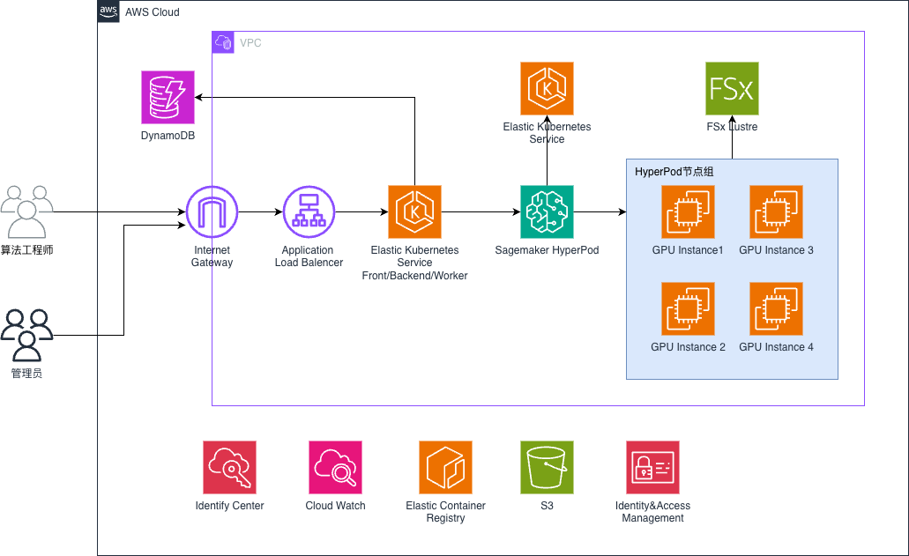

# HyperPod UI Platform

[English](README.md) | **简体中文**

基于 Amazon SageMaker HyperPod + Amazon EKS 的多租户 ML 平台。用一个 Web 界面统一管理工作空间、开发机、训练任务、推理服务, 以及配额、监控与日志。

## 为什么选择 HyperPod UI Platform

SageMaker HyperPod 提供了高可用、可大规模扩展的 GPU 集群, 但让多个团队共享一个集群时, 每个人都得直接面对 Kubernetes YAML、`kubectl` 和 Kueue: GPU 被谁占着看不见, 任务为什么排队说不清, 一个团队还可能误删另一个团队的任务。本项目在 HyperPod 之上提供一个自助式门户: 平台管理员把集群划分成受管控的工作空间, 算法工程师在浏览器里完成开发、训练和模型部署, 全程不碰 Kubernetes。

**核心优势**

- **覆盖 ML 全生命周期**: 从 Notebook 到分布式训练再到生产推理服务, 一个界面走完。包括开发机 (JupyterLab / Code Editor / 原生 SSH)、PyTorch 与 Ray 训练, 以及单机推理、llm-d 多机推理和 NVIDIA Dynamo 多机推理。
- **基于 HyperPod 与 AWS 原生能力, 不自造调度器**: 工作空间直接对应 HyperPod task governance 的计算配额 (namespace + Kueue 队列 + ResourceQuota); 优先级档来自 HyperPod cluster policy; 开发机用 SageMaker Spaces add-on; 训练用 HyperPod Training Operator 并自带 auto-resume。平台不在 HyperPod 集群里加装任何自研 operator 或 webhook, 始终贴近 AWS 官方支持路径, 升级平滑。
- **公平、可管控的 GPU 共享**: GPU / CPU 资源池分离, 工作空间级配额 (支持借用), 优先级档, 按工作空间开关抢占; 任务总览展示真实排队顺序, 管理员可调整排队中任务的优先级。所有任务都只能从管理员预设的资源模板中选规格, 用户无法随意申请资源。
- **训练默认具备容错能力**: 任务运行在 HyperPod auto-resume 与 `hyperpodrun` 弹性 agent 之上, 被抢占或失败的任务会自动重新排队, 并从 checkpoint 续训。
- **开箱即用的可观测性**: 指标方面, 有按 Pod 过滤的 DCGM GPU 指标 (按 Pod 而非按节点统计, 碎片化调度下利用率不被稀释)、SGLang 推理性能、Kueue 队列与配额用量、FSx 性能, 以及工作空间 GPU 利用率与占用卡数图。日志方面, 有实时日志和历史日志 (支持跨 Pod 搜索), 还可选归档到 S3 长期保留。
- **带护栏的共享数据**: 每个工作空间可挂载多块 FSx for Lustre, 按子目录隔离, 并支持目录级容量配额 (Lustre project quota); 也支持挂载 S3。开发机 home 目录是独立 EBS 卷, 停机再开机数据仍在。
- **企业级身份与安全**: 通过 Amazon Cognito 登录, 可选对接 IAM Identity Center (SAML, 支持跨账号)。三级角色 (平台管理员 / 工作空间管理员 / 成员), 每个接口都做鉴权; 审计日志写入 DynamoDB。用户可创建个人 API Token 与 Secret, 供 CLI / CI 使用。默认私网部署: internal ALB + private EKS API endpoint。
- **提升开发效率**: 分段式创建表单, 提交前可预览 YAML, 任何任务都能一键克隆重跑。镜像仓库支持在线 Dockerfile 构建 (AWS CodeBuild)。推理 API 兼容 OpenAI。开发机、训练和推理可在工作空间内只读分享。开发机提供固定的 SSH DNS 名, 方便用 VS Code Remote-SSH 连接。
- **运维负担低**: DynamoDB (按需计费) 作为唯一数据源, 无需运维 RDS / Redis。API 无状态, 可水平扩展。Go controller 把集群状态实时投影进 DynamoDB。整套平台由 AWS CDK 加三个脚本完成部署。
- **面向全球团队**: 界面中英双语 (English / 简体中文), 内置应用内使用文档与 GPU 故障排查手册。

## 功能

| 功能 | 能做什么 | 实现 |
|---|---|---|
| 工作空间 | 团队隔离单元: 成员、配额、FSx/S3 挂载、工作空间管理员 | HyperPod task governance `ComputeQuota` → namespace + `ResourceQuota` + Kueue queue |
| 开发机 | 浏览器内 JupyterLab / Code Editor, 固定 DNS 名的原生 SSH, 持久化 EBS home | SageMaker Spaces add-on (`workspace.jupyter.org` CRD) |
| 训练任务 | 分布式 PyTorch + auto-resume, 分段式创建表单, 克隆重跑 | HyperPod Training Operator + `HyperPodPyTorchJob` (`hyperpodrun`) |
| Ray 任务 | Ray 分布式训练 | KubeRay `RayJob` |
| 单机推理 | SGLang (也支持 vLLM / TRT-LLM), 模型来自 FSx/S3, 兼容 OpenAI API, 通过 ClusterIP / internal ALB / 可选 SageMaker endpoint 暴露 | HyperPod `InferenceEndpointConfig` |
| 多机推理 | 单机装不下的大模型: 统一 gateway + 多组 leader/worker 推理副本, 按缓存命中路由 | llm-d (`LeaderWorkerSet` + sgl-gateway) |
| Dynamo 推理 | 超大模型 (如 DeepSeek-V3) 跨节点 TP/EP 推理, 兼容 OpenAI API | NVIDIA Dynamo (`DynamoGraphDeployment` + Grove) |
| 资源模板 | 管理员预设实例规格, 开发机/训练/推理共用; 用户只能选, 不能手填 | 按工作空间维护, 区分 GPU/CPU 资源池 |
| 配额与调度 | GPU/CPU 资源池、优先级档、按工作空间开关抢占、任务总览 (排队顺序 + 改优先级) | Kueue ClusterQueue/LocalQueue + HyperPod task governance cluster policy |
| 存储 | 多块 FSx for Lustre, 目录级容量配额, FSx 性能监控, S3 挂载 | FSx for Lustre 2.15 project quota |
| 镜像仓库 | ECR 镜像目录 + 在线 Dockerfile 构建 | Amazon ECR + AWS CodeBuild |
| 监控与日志 | GPU/Pod/SGLang 指标, Kueue 队列页, 实时 + 历史日志 (跨 Pod 搜索), 可选 S3 日志归档 | ECharts + Amazon Managed Service for Prometheus + CloudWatch Logs (Fluent Bit) |
| 分享与令牌中心 | 工作空间内只读分享; 个人 API Token 与 key-value Secret | DynamoDB |
| 身份与权限 | 平台管理员 / 工作空间管理员 / 成员三级权限, 审计日志 | Cognito user pool (+ IAM Identity Center SAML) |

> Ray 任务依赖的 KubeRay operator 由 `deploy/deploy-platform.sh` 的 `init` 步骤自动安装; Dynamo 推理需自行在业务集群安装 NVIDIA Dynamo platform (含 Grove)。

## 架构



## 部署

> **部署入口文档: [`docs/deployment-guideline.zh-CN.md`](docs/deployment-guideline.zh-CN.md)**: 从零到能跑的完整流程。

整体两个 EKS 集群 (同 VPC):
- **业务集群** (控制台 custom setup 建): HyperPod / FSx / 开发机 / 训练 / 推理
- **平台集群** (CDK 建): 前后端 + controller

部署主线 (详见入口文档):

```
①控制台建 VPC / EKS+HyperPod / FSx   →   ②填 infrastructure/cdk.json
   →  ③deploy/cluster-prereq.sh        (业务集群准备)
   →  ④deploy/deploy-platform.sh cdk init build apply   (平台部署)
   →  ⑤收尾: cognito-callback.sh + cross-cluster-sg.sh + 域名/IdC
```

三个部署脚本 (`deploy/`):

| 脚本 | 阶段 |
|---|---|
| `cluster-prereq.sh` | 业务集群准备 (EBS CSI / SSM / Prefix Delegation / Spaces / external-dns / logging / template / fsx-admin / LWS) |
| `deploy-platform.sh` | 平台部署 (cdk → init → build → apply) |
| `cognito-callback.sh` | 收尾 (回填 Cognito callback) |

推荐在 VPC 内的一台 EC2 上部署, 见 [`docs/ec2-deployer-setup.zh-CN.md`](docs/ec2-deployer-setup.zh-CN.md)。

## 技术栈

- **后端**: Python 3.11 + FastAPI + aioboto3 + DynamoDB (单数据源)
- **Controller**: Go + controller-runtime (把 CR / Kueue Workload / Pod 状态投影到 DynamoDB)
- **前端**: Vite 5 + React 18 + TypeScript 5 + Ant Design 5 + ECharts 5, i18next (en-US / zh-CN)
- **基础设施**: AWS CDK v2 (aws-cdk-lib 2.150)
- **集群**: EKS 1.35 + SageMaker HyperPod + Kueue + amazon-sagemaker-spaces
- **数据/认证**: DynamoDB + Cognito + Amazon Managed Service for Prometheus

## 仓库结构

```
infrastructure/              CDK (Python): 平台集群 + DynamoDB / Cognito / IAM / ECR / Pod Identity
services/platform-api/       FastAPI 后端 (DynamoDB 单数据源)
services/platform-controller/ Go controller: watch 业务集群, 状态写入 DynamoDB
frontend/                    Vite + React 18 + Ant Design 5 前端
deploy/                      部署脚本 + Kubernetes manifest
docs/                        部署 / 接入 / 设计文档
```

## 文档索引

所有文档均提供英文版和简体中文版 (`*.zh-CN.md`), 可通过每页顶部的链接切换语言。

| 文档 | 内容 |
|---|---|
| [deployment-guideline](docs/deployment-guideline.zh-CN.md) | ⭐ **部署入口**: 从零部署全流程 |
| [ec2-deployer-setup](docs/ec2-deployer-setup.zh-CN.md) | EC2 部署机 setup |
| [identity-center-cognito-configuration](docs/identity-center-cognito-configuration.zh-CN.md) | IAM Identity Center (SAML) 接入 Cognito |
| [internal-domain-deployment](docs/internal-domain-deployment.zh-CN.md) | 内网域名 + 内网证书 + ALB HTTPS |
| [internal-alb-with-domainname](docs/internal-alb-with-domainname.zh-CN.md) | CloudFront + VPC Origin + Internal ALB |
| [WebSocketProxyFix](docs/WebSocketProxyFix.zh-CN.md) | CloudFront 下 Code Editor WebSocket 问题 |
| [controller-deployment](docs/controller-deployment.zh-CN.md) | platform-controller 部署 |
| [fsx-storage-quota-design](docs/fsx-storage-quota-design.zh-CN.md) | FSx 目录配额方案 |
| [fsx-mount-pv-pvc-cr-explained](docs/fsx-mount-pv-pvc-cr-explained.zh-CN.md) | FSx 挂载机制 (PV / PVC / CR) |
| [dynamo-inference-sync-design](docs/dynamo-inference-sync-design.zh-CN.md) | Dynamo 推理状态同步设计 |
| [i18n-glossary](docs/i18n-glossary.zh-CN.md) | 中英术语表 + 如何新增可翻译文案 |

## 安全

本项目是用于演示和评估的示例 (sample)。用于生产环境前, 请按所在组织的安全要求审查并加固。重点包括:

- **网络暴露**: ALB 默认是 `internal`, EKS API endpoint 默认仅私网访问。请保持该配置, 通过 VPN / Direct Connect / 堡垒机访问门户。
- **TLS**: 在 `cdk.json` 中设置 `albCertificateArn`。不设置时 ALB 只监听 HTTP:80, token 在 VPC 内明文传输。
- **EKS**: 开启控制平面日志 (api、audit、authenticator), 并为 Kubernetes Secret 启用 KMS 信封加密。
- **Kubernetes 工作负载**: `deploy/k8s/` 下的示例 manifest 未设置 `securityContext` (非 root、只读根文件系统、去除 capabilities、seccomp)、NetworkPolicy 和镜像 digest; `maxpods-patcher` 在节点上以特权模式运行。请应用你自己的 Pod 安全基线。
- **数据保护**: 按合规要求开启 DynamoDB 时间点恢复 (PITR)、ALB 访问日志和 S3 服务器访问日志。
- **认证**: 检查 Cognito 设置 (MFA、token 有效期; 本示例中 ID/access token 默认 1 天)。
- **IAM**: 各角色权限限定在 `cdk.json` 配置的资源范围内。部署前请审查, 尤其是 `platformS3Buckets`。
- **镜像构建**: 在线镜像构建会在特权 CodeBuild 环境中运行用户提供的 Dockerfile, 请限制可触发构建的人员。

安全问题上报方式见 [CONTRIBUTING](CONTRIBUTING.md#security-issue-notifications)。

## License

本项目使用 MIT-0 许可证, 详见 [LICENSE](LICENSE) 文件。
