# Identity Center + Cognito Configuration

**English** | [简体中文](identity-center-cognito-configuration.zh-CN.md)

Connect IAM Identity Center as a SAML IdP to the Cognito user pool created by CDK. There are three steps: (1) create an Identity Center application, (2) create a SAML identity provider in Cognito, (3) update the Cognito App client to sign in with Identity Center.

> `hypd-0625-123456789012` / `us-west-2` in this document are example environment values. Use the projectName/account/region from your own cdk.json.

---

## 1. Create an Identity Center Application

In the AWS console, open **IAM Identity Center** → **Applications** → **Add application**.

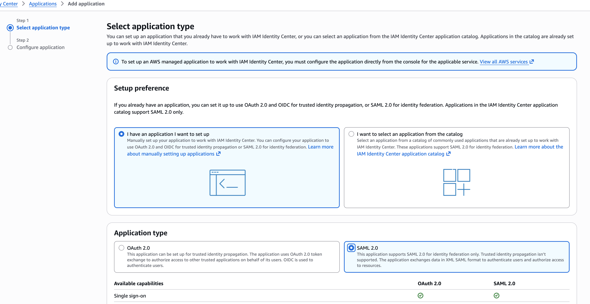

Enter a **Display name**.

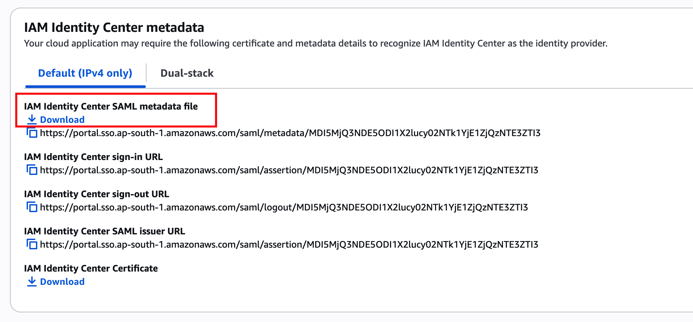

Download the metadata XML file shown in the screenshot above.

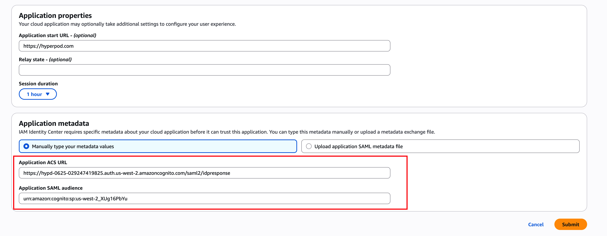

In the screenshot above, **Application ACS URL** = `https://hypd-0625-123456789012.auth.us-west-2.amazoncognito.com/saml2/idpresponse`

> ⚠️ Replace `https://hypd-0625-123456789012.auth.us-west-2.amazoncognito.com` with the domain name of the Cognito user pool created by CDK (in the AWS console, open Cognito, select the user pool created by CDK, and find its Domain name; see the screenshot below).

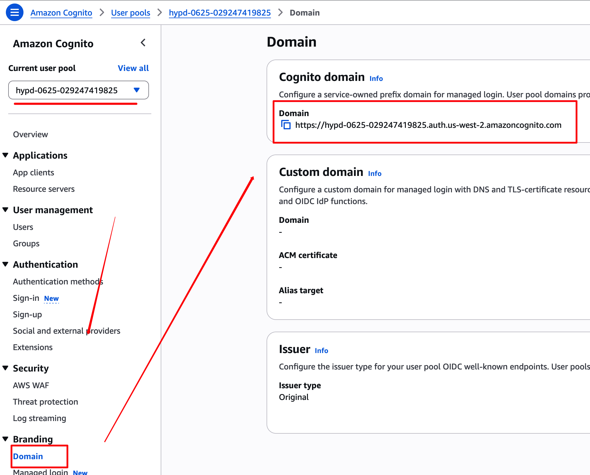

Application SAML audience = `urn:amazon:cognito:sp:us-west-2_EXAMPLE01`
> ⚠️  Replace us-west-2_EXAMPLE01 with your actual Cognito User pool ID; see the screenshot below.

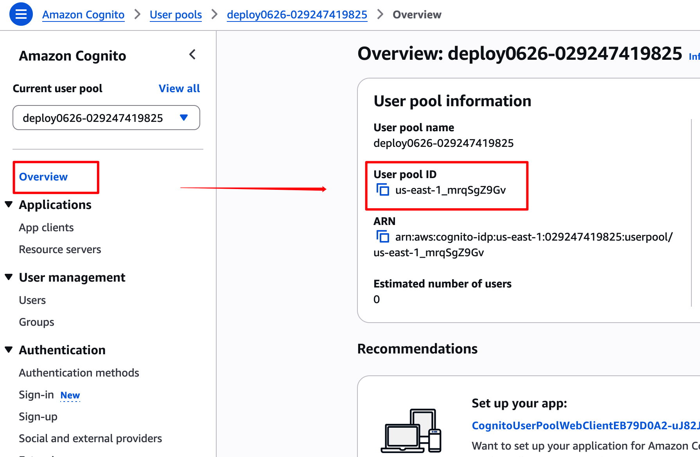

In Identity Center, edit the **attribute mappings**:

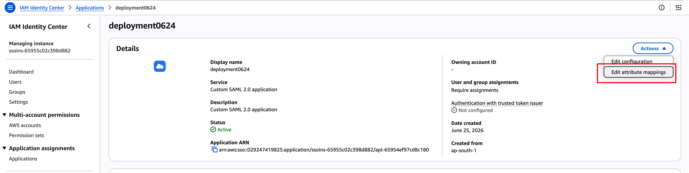

Enter the following:

```
${user:subject}
http://schemas.xmlsoap.org/ws/2005/05/identity/claims/emailaddress   ${user:email}
http://schemas.xmlsoap.org/ws/2005/05/identity/claims/name           ${user:name}
```

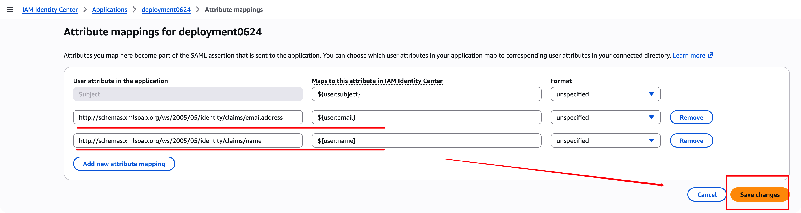

Finally, add the users or groups that are allowed to access the application: in the Application, choose Assign users and groups.
---

## 2. Create a Custom Provider in Cognito

Open **Cognito** in the AWS console:

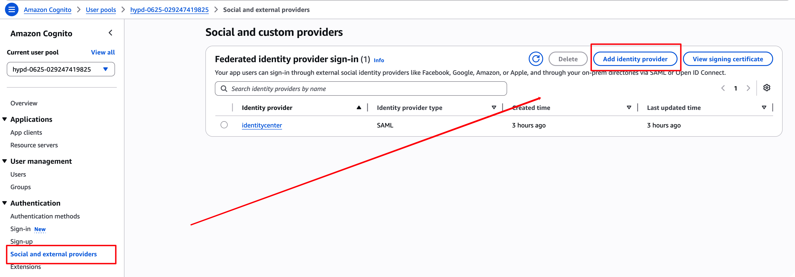

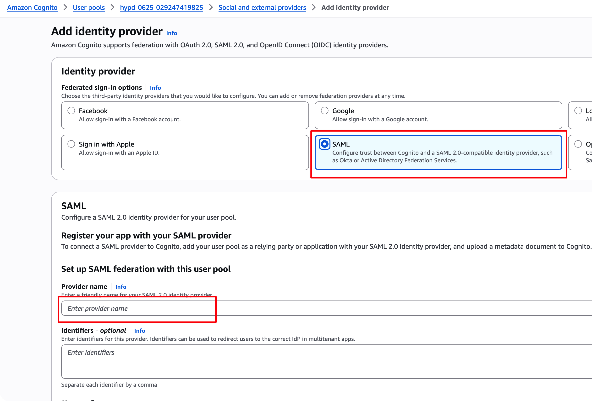

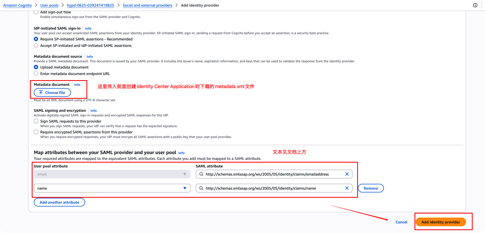

---

## 3. Set the Cognito App Client's Identity Provider to Identity Center

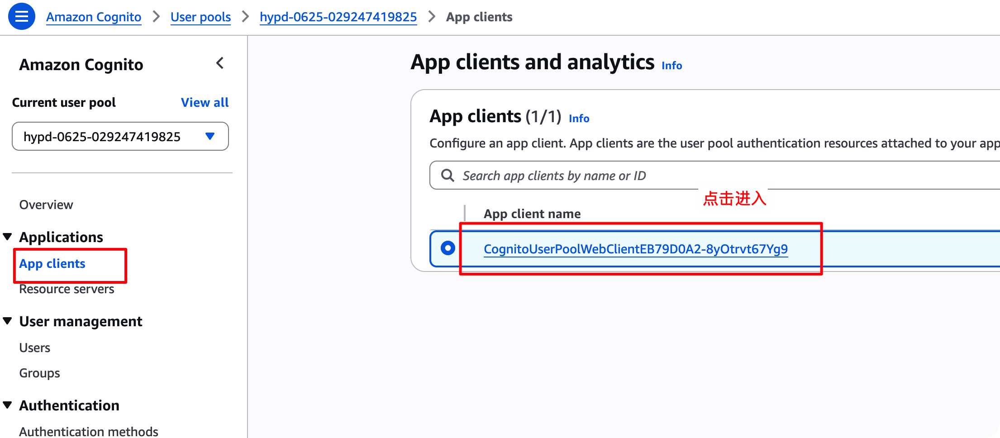

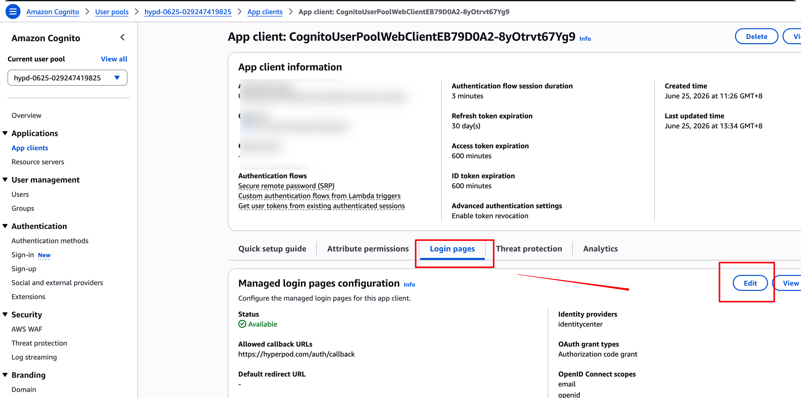

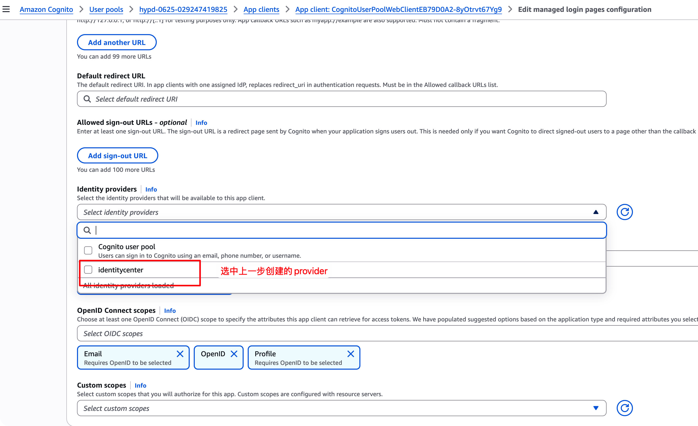

Save your changes.

---

## 4. Cross-Account Identity Store (Application Account ≠ IdC Account)

When an admin adds Workspace members, the backend queries IAM Identity Center in real time to get each user's actual email / display_name (`identitystore:GetUserId` + `DescribeUser`). **By default, IdC is assumed to be in the same account as the application**: the backend simply calls it with the pod's local credentials (Pod Identity).

In AWS Organizations, however, **IAM Identity Center usually lives only in the organization's management account (or a delegated administrator account)**, while the platform application is deployed in a different member account. In that case the application's local credentials **cannot see** the management account's Identity Store, and calls fail with `ResourceNotFoundException`.

Solution: in the management account, create a **read-only role** that trusts the application account's `platform-api-role`. The backend first calls `sts:AssumeRole` to get temporary credentials, then uses them to query IdC.

> Delegated Administrator is an alternative: register the application account as an IdC delegated administrator, which requires almost no code changes. However, it is an organization-level change, each organization can have only one delegated administrator, and it grants IdC management capabilities far beyond "read-only user access". From a least-privilege standpoint, the AssumeRole approach below is recommended.

### 4.1 Create a Read-Only Role in the Management Account

In the **management account where IdC lives**, create an IAM role (example name `hyperpod-idc-readonly`):

**Permissions policy** (IdC does not support resource-level ARNs, so Resource must be `*`):

```json
{
  "Version": "2012-10-17",
  "Statement": [
    {
      "Effect": "Allow",
      "Action": ["identitystore:GetUserId", "identitystore:DescribeUser"],
      "Resource": "*"
    }
  ]
}
```

**Trust policy** (Principal = the application account's platform-api-role, i.e. the `PlatformApiRoleArn` CDK output):

```json
{
  "Version": "2012-10-17",
  "Statement": [
    {
      "Effect": "Allow",
      "Principal": { "AWS": "arn:aws:iam::<APP_ACCOUNT_ID>:role/<projectName>-platform-api-role" },
      "Action": "sts:AssumeRole"
    }
  ]
}
```

> Cross-account AssumeRole requires **authorization on both sides**: this role trusts the app role, and the app-side platform-api-role must also have `sts:AssumeRole` permission on this role. CDK adds the latter automatically (see below), so no manual configuration is needed.

### 4.2 Configure the Application Account

Put the ARN of the role created above into `infrastructure/cdk.json`:

```json
"idcAssumeRoleArn": "arn:aws:iam::<MGMT_ACCOUNT_ID>:role/hyperpod-idc-readonly",
```

Once it is set:
- CDK's `platform-api-role` is automatically granted **only** `sts:AssumeRole` (target = that ARN), and is no longer granted `identitystore:*` in its own account;
- After startup, the backend first calls AssumeRole when querying IdC (temporary credentials are cached for 1h), then makes the call.

⚠️ **`idcIdentityStoreId` and `idcRegion` are still required**, and must be set to **the values of the store in the management account**:
- `idcIdentityStoreId` (`d-xxxx`) — it is not part of the role ARN, and it is a required API parameter;
- `idcRegion` — the region of the IdC instance. The role ARN is a global resource with no region, so the client created after assuming the role must specify it explicitly; otherwise you still get `ResourceNotFoundException`.

For same-account deployments, leave `idcAssumeRoleArn` empty; behavior is unchanged.
