# Identity Center + Cognito 配置

[English](identity-center-cognito-configuration.md) | **简体中文**

将 IAM Identity Center 作为 SAML IdP 接入 CDK 创建的 Cognito user pool。三步:① 建 Identity Center application,② Cognito 建 SAML identity provider,③ 改 Cognito App client 用 Identity Center 登录。

> 文中 `hypd-0625-123456789012` / `us-west-2` 是示例环境值,实际以你 cdk.json 的 projectName/account/region 为准。

---

## 一、创建 Identity Center Application

在 AWS console 打开 **IAM Identity Center** → **Applications** → **Add application**。

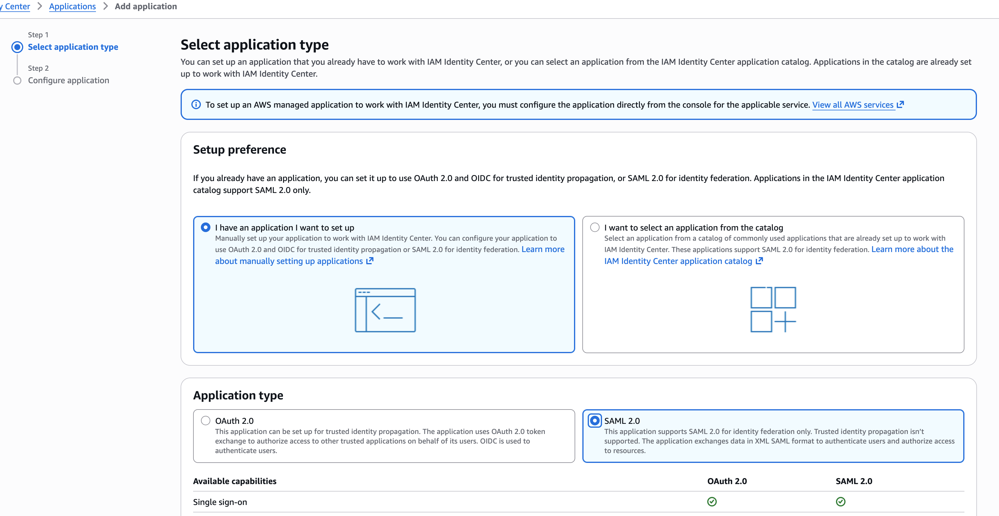

填写 **Display name**

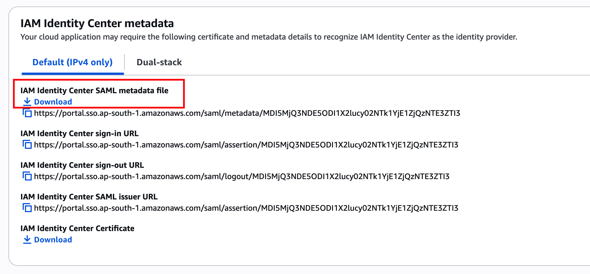

下载以上图片中的 metadata xml文件

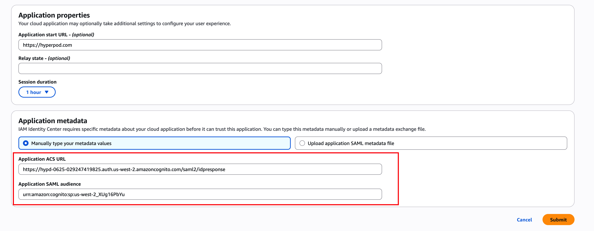

以上图片中 **Application ACS URL** = `https://hypd-0625-123456789012.auth.us-west-2.amazoncognito.com/saml2/idpresponse`

> ⚠️ 需要把 `https://hypd-0625-123456789012.auth.us-west-2.amazoncognito.com` 替换为 CDK 创建的 Cognito user pool 的 domain name(在 AWS console Cognito 选中 CDK 创建的 user pool 的 Domain name,详见下图)。

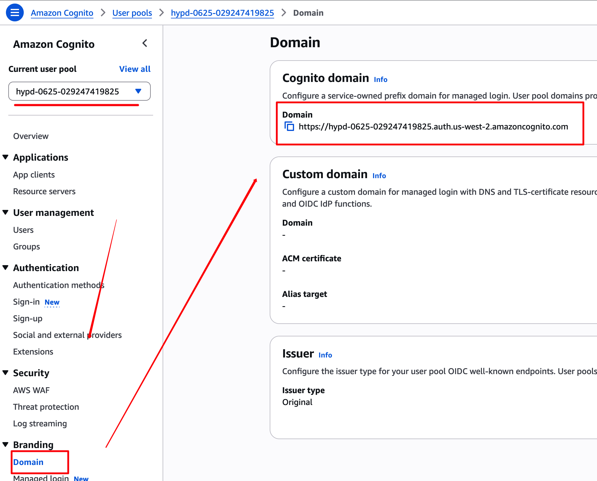

Application SAML audience = `urn:amazon:cognito:sp:us-west-2_EXAMPLE01`
> ⚠️  需要把us-west-2_EXAMPLE01 替换为真实的Cognito User pool ID, 详见下图

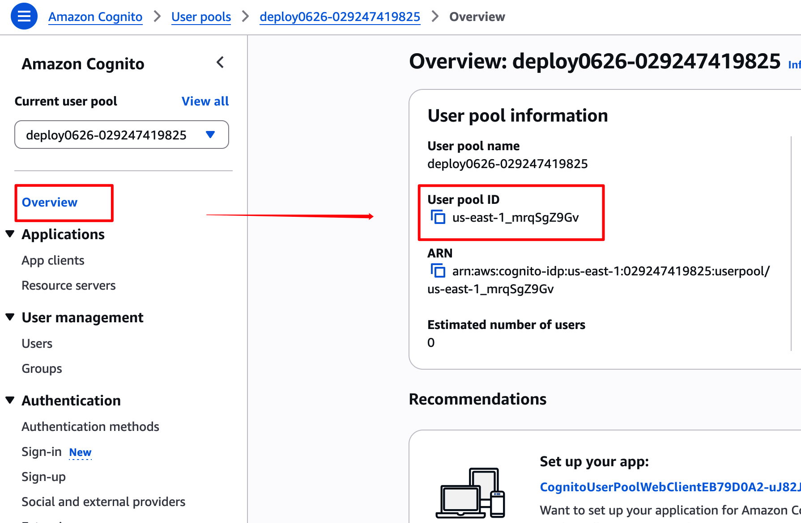

在 Identity Center 里,修改 **attribute mappings**:

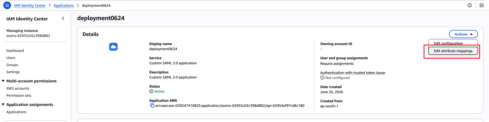

填入下面的内容:

```
${user:subject}
http://schemas.xmlsoap.org/ws/2005/05/identity/claims/emailaddress   ${user:email}
http://schemas.xmlsoap.org/ws/2005/05/identity/claims/name           ${user:name}
```

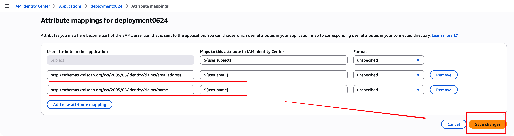

最后需要把允许访问应用的人或者组加入 Application， 在Application中点击Assign users and groups。
---

## 二、Cognito 创建 custom provider

进入 AWS console **Cognito**:

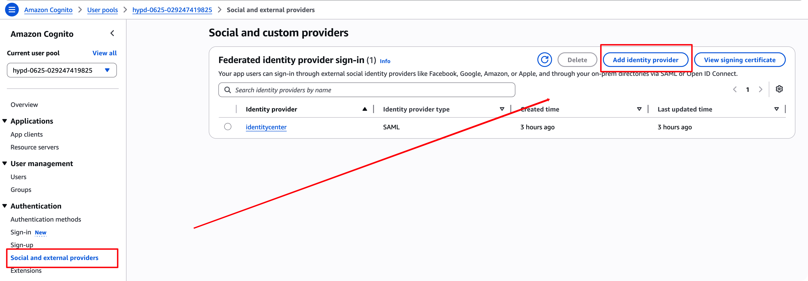

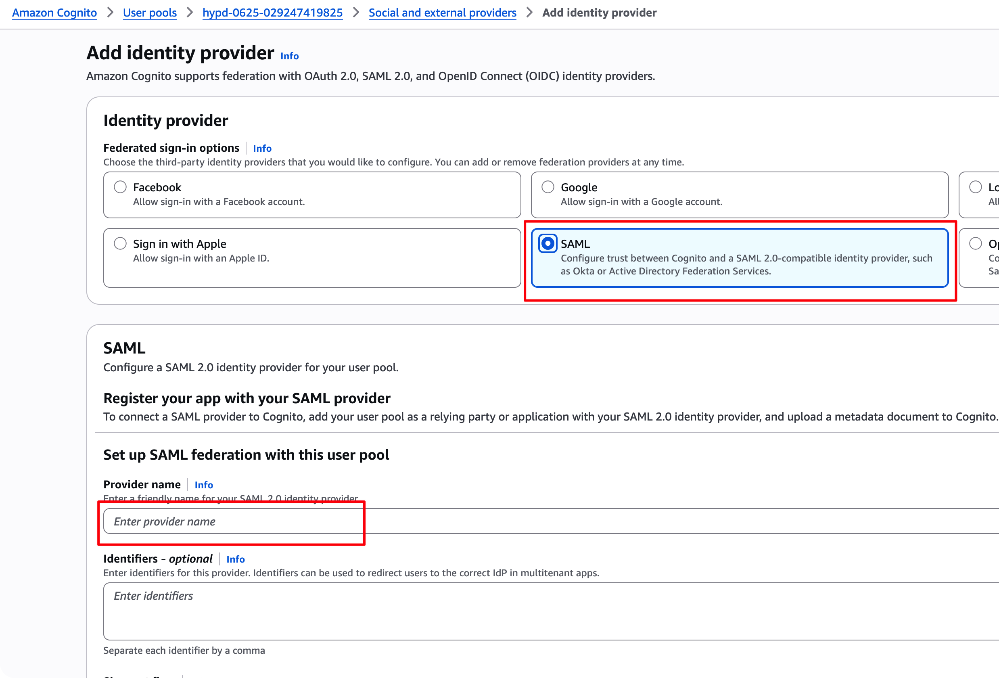

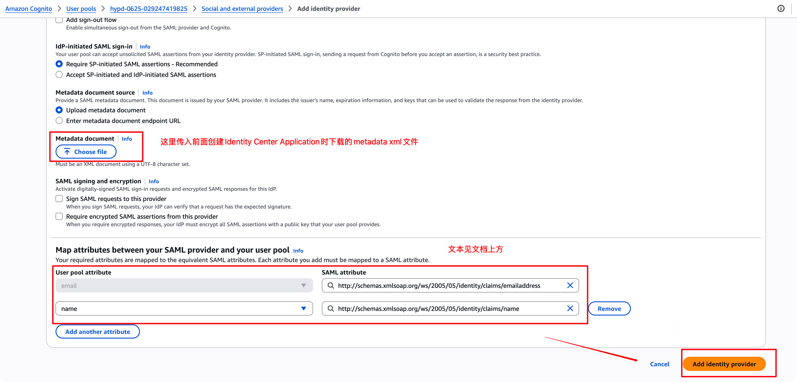

---

## 三、修改 Cognito App client 的 Identity provider 为 Identity Center

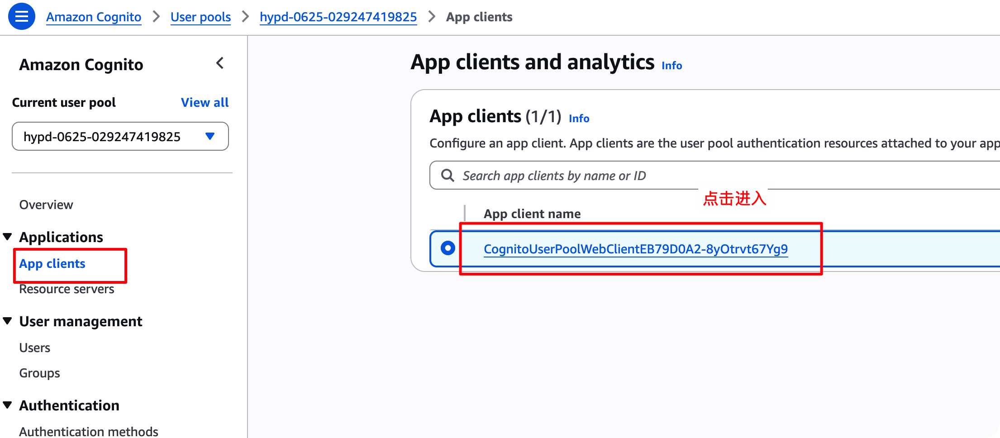

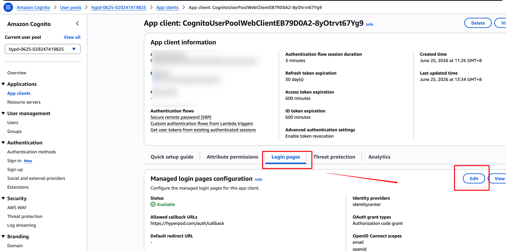

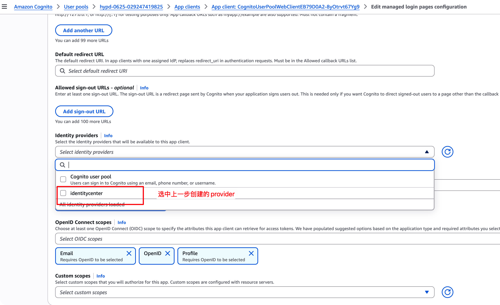

保存即可。

---

## 四、跨账号 Identity Store(应用账号 ≠ IdC 账号)

后端 admin 加 workspace 成员时,会实时查 IAM Identity Center 拿真实 email / display_name(`identitystore:GetUserId` + `DescribeUser`)。**默认假设 IdC 与应用在同一个账号**:后端直接用 pod 的本地凭证(Pod Identity)调用即可。

但在 AWS Organizations 里,**IAM Identity Center 通常只在 org 管理账号(或委派管理员账号)里**,而平台应用部署在另一个成员账号。此时应用的本地凭证**看不到**管理账号的 Identity Store,调用会报 `ResourceNotFoundException`。

解决办法:在管理账号里建一个**只读角色**,信任应用账号的 `platform-api-role`;后端先 `sts:AssumeRole` 拿临时凭证,再用临时凭证查 IdC。

> 委派管理员(Delegated Administrator)是另一条路——把应用账号注册成 IdC 委派管理员,代码几乎零改动。但那是 org 级变更、每个 org 仅一个委派管理员、且授予的 IdC 管理能力远超"只读用户"。最小权限角度推荐下面的 AssumeRole 方案。

### 4.1 在管理账号建只读角色

在 **IdC 所在的管理账号**里建一个 IAM 角色(示例名 `hyperpod-idc-readonly`):

**权限策略**(IdC 不支持资源级 ARN,Resource 只能 `*`):

```json
{
  "Version": "2012-10-17",
  "Statement": [
    {
      "Effect": "Allow",
      "Action": ["identitystore:GetUserId", "identitystore:DescribeUser"],
      "Resource": "*"
    }
  ]
}
```

**信任策略**(Principal = 应用账号的 platform-api-role,即 CDK 输出的 `PlatformApiRoleArn`):

```json
{
  "Version": "2012-10-17",
  "Statement": [
    {
      "Effect": "Allow",
      "Principal": { "AWS": "arn:aws:iam::<APP账号ID>:role/<projectName>-platform-api-role" },
      "Action": "sts:AssumeRole"
    }
  ]
}
```

> 跨账号 AssumeRole 是**双向授权**:这里信任 app role,且 app 侧 platform-api-role 还要有 `sts:AssumeRole` 到本角色的权限。后者由 CDK 自动加(见下),无需手动配。

### 4.2 在应用账号填配置

把上面建好的角色 ARN 填进 `infrastructure/cdk.json`:

```json
"idcAssumeRoleArn": "arn:aws:iam::<MGMT账号ID>:role/hyperpod-idc-readonly",
```

填了之后:
- CDK 的 `platform-api-role` 自动**只授予** `sts:AssumeRole`(目标=该 ARN),不再给本账号 `identitystore:*`;
- 后端启动后查 IdC 会先 AssumeRole(临时凭证带 1h 缓存),再调用。

⚠️ **`idcIdentityStoreId` 和 `idcRegion` 仍然必填**,且要填**管理账号那个 store 的值**:
- `idcIdentityStoreId`(`d-xxxx`)— 角色 ARN 里没有它,是 API 必填入参;
- `idcRegion` — IdC 实例所在 region;角色 ARN 是全局资源不含 region,assume 后建 client 必须显式指定,否则仍 `ResourceNotFoundException`。

同账号部署则 `idcAssumeRoleArn` 留空,行为不变。
